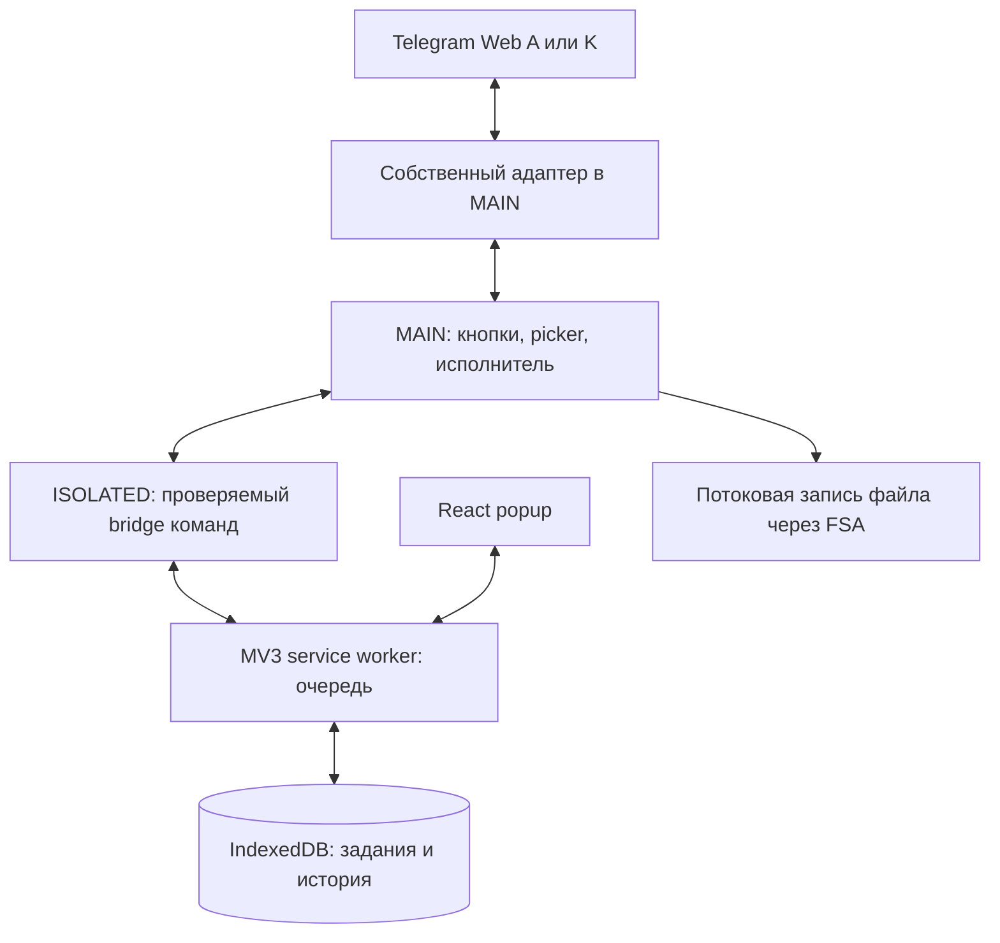

# Telegram All Downloader — план продукта и реализации

Дата: 9 октября 2026. Рабочее название: **Telegram All Downloader**.

Это исторический продуктовый план, составленный до реализации. Его требования и backlog сохраняются; ниже зафиксированы принятые при разработке решения. Реализован новый Telegram All Downloader. Текущие результаты живых проверок и ограничения ведутся отдельно в [docs/compatibility.md](docs/compatibility.md), установка — в [README.md](README.md).

### Статус реализации и принятые решения

- Созданы адаптеры Web A/K, последовательный потоковый исполнитель, общая очередь в IndexedDB, восстановление координатора, кнопки возле вложений, popup, RU/EN и темы. Автоматические unit/integration/E2E используют собственные fixtures; сами по себе они не доказывают полную совместимость с production Telegram.
- Установлен стек WXT + TypeScript + React, Manifest V3. Для зависимостей выбран **npm** с `package-lock.json` и `npm ci`, Node.js 22 из `.nvmrc`.
- Сохранение выполняется через **File System Access в MAIN-контексте Telegram**. Подготовка метаданных ограничена тремя одновременными операциями. Picker открывается синхронно по пользовательскому клику; writer — при начале передачи из очереди. Закрытие Telegram-вкладки прерывает зависимую загрузку; повтор требует нового выбора места сохранения.
- Байты и файловый handle остаются в исходной вкладке. Документы читаются порциями до 512 KiB; технический предел исполнителя — 4 GiB. Для фото Web A, возвращаемого клиентом целиком, установлен отдельный предел 32 MiB. Эти пределы не являются результатами живого измерения больших файлов.
- Фактические разрешения: **`storage`** и узкий host access `https://web.telegram.org/*`. `downloads`, `scripting`, `offscreen`, cookies и debugger не запрашиваются. Статические content scripts работают на `/a/` и `/k/`.
- Исходники находятся в [alex100cent/telegram-all-downloader](https://github.com/alex100cent/telegram-all-downloader), лицензия — [MIT](LICENSE). Сторонний runtime-код перечислен в [THIRD_PARTY_NOTICES.md](THIRD_PARTY_NOTICES.md) и поставляется с ZIP. Донат-кнопка скрыта, пока не задан реальный URL.
- M1–M3 реализованы в коде. Полная приёмка M0/M4 зависит от живой матрицы, а не от наличия кода или прохождения fixtures. Яндекс.Браузер не установлен в среде разработки; его проверку пользователь выполнит самостоятельно. Остаток приёмки описан в [docs/manual-testing.md](docs/manual-testing.md).

Архитектурные подробности текущего пути: [docs/architecture/transport.md](docs/architecture/transport.md), [Web A](docs/architecture/web-a.md), [Web K](docs/architecture/web-k.md). Разделы о других путях сохранения ниже сохраняют историю рассмотренных вариантов и не означают их наличие в MVP.

## 1. MVP: сначала надёжно скачать одно вложение

**Целевой результат MVP:** пользователь открывает Telegram Web, нажимает кнопку рядом с конкретным вложением и получает именно этот файл целиком, в доступном исходном качестве, с правильным именем. Это работает в публичных и доступных пользователю закрытых чатах, включая режим запрета сохранения, на проверенных версиях Web A и Web K.

### Границы, согласованные с пользователем

- Один файл за действие. Массовый выбор, целый альбом и выгрузка истории — после MVP.
- Все типы вложений в сообщениях: фото, видео, музыка и подкасты, голосовые, кружочки, GIF/анимации, произвольные документы, стикеры.
- Telegram Web `/a/` и `/k/` — оба обязательны.
- Chrome и Яндекс.Браузер на **macOS**. Windows — следующий этап; Linux, Firefox, Safari и мобильные браузеры не входят в первоначальную поддержку.
- Бесплатное расширение, открытый исходный код, добровольные донаты. Без подписки, квот скачивания и отдельного аккаунта расширения.
- Истории и аватары — после MVP.
- В popup по иконке расширения: загрузки и компактный блок «Купить кофе разработчику».

### Первоначальный порядок работ внутри MVP

| Шаг | Работа | Результат / условие перехода |
|---|---|---|
| M0 | Проверить получение конкретного медиа и запись на диск в четырёх комбинациях браузер × Web-клиент | Таблица доказанных возможностей; небольшой собственный прототип; решение о транспорте для каждого адаптера |
| M1 | Создать проект, модели, протокол сообщений, хранилище, тестовые данные | Расширение устанавливается в обоих браузерах; модули не зависят от случайных деталей DOM |
| M2 | Реализовать вертикальный сценарий аудио, затем остальные типы | Нажатие → точное вложение → полный файл → подтверждённый результат; одинаковая семантика A/K |
| M3 | Добавить кнопки, минимальную очередь, popup и обработку ошибок | Повторные клики не создают дубли; закрытие popup не прерывает работу |
| M4 | Проверить матрицу, подготовить установочный ZIP и инструкции | MVP можно установить и использовать на macOS; ограничения явно описаны |

**M0 — обязательный этап, а не дополнительный исследовательский проект.** Главные риски находятся в доступе к данным Telegram и сохранении больших файлов. Первоначальный порядок предполагал проверку этих частей до интерфейса, начиная с музыки/подкастов. Реализация и проверки на собственных fixtures уже сделаны; живая приёмка остаётся самостоятельным обязательным этапом.

Если M0 не находит надёжного пути для обязательного типа в одном клиенте, это блокер соответствующей ячейки MVP. Не объявлять поддержку «всех медиа», не подменять файл превью и не снимать требование незаметно. Зафиксировать результат, предложить конкретную альтернативу и обсудить изменение объёма с владельцем.

### Что входит в минимальный интерфейс

- Кнопка скачивания возле вложения; для фото/видео также в открытом просмотрщике. Одна операция на одно вложение, включая отдельный элемент альбома.
- Название, тип и размер, если он известен; понятный статус на кнопке и в popup.
- Последовательная очередь из файлов, на которые пользователь нажал по одному. Один активный файл по умолчанию; это не массовый сбор истории.
- Отмена, повтор неудачной загрузки, предотвращение повторного запуска того же задания.
- Локальная история, переживающая закрытие popup и перезапуск фонового процесса.
- Переход к исходному сообщению, когда адаптер умеет восстановить ссылку; показать файл в папке для способов сохранения, где это поддерживается.
- Светлая/тёмная тема, русский и английский интерфейс, управление с клавиатуры.
- Короткая инструкция, ссылка на сообщение о проблеме, необязательный донат.

### Критерии готовности MVP

1. Все строки матрицы вложений из раздела 3 проходят в Chrome A, Chrome K, Яндекс A, Яндекс K на macOS. Версии браузеров и дата проверки записаны.
2. На собственных тестовых данных сохраняется выбранный документ: совпадают ожидаемые байты/хеш, а не только имя и длительность. Для преобразованных Telegram фото используется эталон доступного в Telegram файла.
3. Скачиваются непрослушанные, непросмотренные и частично проигранные файлы полностью; превью не выдаётся за исходник.
4. Проверены обычный публичный канал, обычный приватный и приватный с запретом сохранения. Флаг приватности и запрет сохранения — отдельные условия.
5. Нет произвольного запуска звука, переключения чужого текущего трека или изменения позиции воспроизведения.
6. Файл размером 1 GiB проходит на потоковом пути без буферизации целиком. Измеряется весь путь: получение в Telegram, транспорт и запись; потоковая запись уже накопленного гигабайтного Blob не считается решением. До релиза дополнительно проверяется файл около 2 GiB; около 4 GiB — если такой файл доступен тестовому аккаунту. Публикуется фактически проверенный предел, а не обещание «любого размера».
7. Offline, отмена, отказ в выборе файла, ошибка записи, истёкший источник и закрытие Telegram-вкладки дают правильное состояние. Неполный файл не обозначается как готовый.
8. Остановка extension service worker не теряет историю и не запускает вторую копию уже выполняемой загрузки.
9. Чужой код/иконки/демонстрации из `Telegram-Downloader` не попадают в сборку; для своих исходников и включённых зависимостей определены лицензии.

## 2. Продукт: чем быть лучше

Основной ориентир по удобству — **[Private video downloader — Telegram Private Video Downloader](https://chromewebstore.google.com/detail/private-video-downloader/gdfhmpjihkjpkcgfoclondnjlignnaap)**, сайт [tgvideodownload.com](https://tgvideodownload.com/). Пользователь ранее покупал его подписку для большого количества загрузок. Его удобство — подтверждённый пользовательский ориентир; техническая реализация этого расширения нами не проверялась.

Наши основные отличия:

1. **Надёжное соответствие сообщению.** Особенно для аудио: выбранный подкаст не заменяется соседним треком из предзагрузки.
2. **Единый понятный процесс для всех вложений.** Голосовое, кружочек и документ не считаются второстепенными вариантами видео.
3. **Честное состояние загрузки.** «Готово» означает сохранённый файл, а ошибка содержит доступное действие для исправления.
4. **Открытый код и работа через текущую вкладку.** Без передачи медиа через наш сервер и без нового входа в Telegram.
5. **Удобная работа с большим количеством файлов после MVP.** Выбор, очередь, фильтры, аккуратные имена и исключение дублей.
6. **Обновляемые адаптеры A/K.** Поломка одного типа или клиента локализована и диагностируется.

### Что означает «любой медиа-контент»

В продукте это все перечисленные типы файлов, которые доступны текущему пользователю в поддерживаемом Telegram Web. Расширение работает и в каналах, куда пользователь уже вступил. Получение доступа к отсутствующему каналу, неоплаченному контенту или удалённому файлу не является функцией продукта. Секретные чаты, звонки, прямые эфиры и недоступные веб-клиенту одноразовые вложения не входят в обещание.

Сохранение в чате с `noforwards` — отдельная обязательная проверка, а не следствие приватности канала. Telegram описывает этот флаг как ограничение сохранения и пересылки; работоспособность нашего пути потребуется подтвердить на тестовом канале. [Telegram: content protection](https://core.telegram.org/api/content-protection).

«Исходное качество» означает лучший полный файл, доступный в Telegram, без дополнительного пережатия расширением. Для фото, отправленного как фото, это не обязательно оригинал до обработки Telegram. Конвертация — отдельная будущая функция.

## 3. Матрица функций и форматов

### Вложения MVP

| Тип | Что сохраняем | Обязательный сценарий |
|---|---|---|
| Фото | Полноразмерный доступный вариант с реальным форматом | Фото из ленты, просмотрщика, отдельный элемент альбома; не миниатюра |
| Обычное видео | Полный доступный исходный файл с аудиодорожкой, если она есть | Ещё не проиграно; проиграно частично; длинное видео |
| Музыка, подкасты, аудиокниги | Исходный аудиофайл: MP3/M4A/OGG/FLAC или иной реальный формат | Prefetch соседнего трека, одинаковые названия, активный плеер |
| Голосовое сообщение | Реальный контейнер/кодек, обычно OGG/Opus | Без принудительного воспроизведения и без ложного расширения `.mp3` |
| Кружочек | Полный видеофайл, обычно MP4 | Звук и вся длительность; не изображение из превью |
| GIF / анимация | Фактический формат, в Telegram это может быть MP4 | Не переименовывать MP4 в `.gif` |
| Документ / файл | Исходные байты и безопасно обработанное оригинальное имя | PDF, ZIP, TXT, медиа как документ, неизвестный MIME, файл без расширения |
| Статический стикер | Исходный файл, например WebP | Не скриншот отрисованного стикера |
| Анимированный / видеостикер | Исходный TGS/WebM или иной предоставленный формат | Непроигранная анимация; формат не заменяется на GIF |

MIME и расширение уточняются по метаданным и содержимому. Примеры в таблице не заменяют определение формата. «Открывается не в каждом системном плеере» не означает, что нужно менять расширение или незаметно перекодировать файл.

### После MVP

| Приоритет | Функция | Зачем нужна / граница |
|---|---|---|
| P1 | Выбрать несколько сообщений; скачать альбом | Ближайшее улучшение повседневного UX; список файлов до запуска |
| P1 | Скачать обнаруженные вложения текущего чата с фильтром по типу | Быстро собрать подкасты/фото; явно показать охват обнаружения |
| P1 | Папка назначения и шаблоны имён | Один выбор папки на пакет, порядок по дате/сообщению |
| P1 | Полный менеджер в отдельной вкладке | Фильтры, поиск, повторы ошибок, отмена группы, переход к источнику |
| P1 | Пропуск ранее скачанного | По устойчивой идентичности медиа; повтор вручную всегда возможен |
| P1 | Windows: Chrome и Яндекс | Отдельная проверка файловых имён, диалогов, записи и установки |
| P2 | Истории, аватары | Новые места обнаружения поверх общего загрузчика; только доступные пользователю |
| P2 | Сканирование истории за период | Пагинация или управляемая прокрутка; прогресс сканирования, остановка, восстановление |
| P2 | ZIP и файл-манифест экспорта | Компактный перенос подборки; потоковая запись, отчёт об ошибках внутри пакета |
| P2 | Параллельные файлы и поддерживаемая докачка | После измерений и проверенного механизма сохранения; не обещать ускорение заранее |
| P3 | Локальная конвертация voice → MP3, анимаций → GIF | Опционально, отдельно от сохранения оригинала; оценить размер и память WASM |
| P3 | Сохранённые наборы фильтров, горячие клавиши, доступные темы форума | Для регулярного использования после стабилизации основного процесса |

Не включать сейчас: собственный сервер медиа, отдельную MTProto-авторизацию, бота-посредника, фоновое круглосуточное зеркало каналов, AI-обработку, собственный медиаплеер, обязательный side panel, сложную платёжную систему.

## 4. UX: основные сценарии

### Скачивание одного файла

1. Пользователь открывает уже авторизованный Telegram Web.
2. Кнопка с доступной подписью «Скачать файл» появляется у поддерживаемого вложения. В компактных блоках она не перекрывает play, длительность и штатные действия.
3. Нажатие фиксирует идентичность вложения. Сразу появляется «Подготовка» или «В очереди»; повторный клик показывает существующее задание.
4. Файл сохраняется в Downloads через браузер, если проверенный backend это позволяет. Если выбран потоковый путь с файловым диалогом, пользователь выбирает файл по явному действию.
5. Когда размер известен, показываются байты и процент; иначе — неопределённый индикатор и количество полученных байтов, если доступно. Подготовка, передача и финализация различаются.
6. После подтверждения записи — «Скачано». Ошибка сохраняется в истории и предлагает «Повторить» либо конкретное действие.

**В альбоме MVP скачивает только выбранный элемент.** Скачивание всего альбома появится в P1.

Если надёжно извлечь оригинал можно только из просмотрщика, кнопка может открыть нужное медиа, сохранив его идентичность. Это допустимый запасной сценарий, но не скрытое проигрывание аудио. Во время M0 определить, какие типы требуют такого перехода.

### Popup

Верхняя строка: название, статус подключения к A/K, настройки. Затем активная загрузка и последние задания: имя, тип, размер/прогресс, отмена или повтор. Ниже — история и помощь. В P1 добавляется «Открыть менеджер».

Внизу — компактная карточка «Нравится расширение? Купить кофе разработчику». Это обычная внешняя ссылка, без рекламной сети, платных ограничений и модального окна после каждой загрузки. Назначение задаётся в конфигурации; до получения реальной ссылки действие скрыто, фиктивный адрес не используется.

Пустые состояния: «Откройте Telegram Web», «Войдите в Telegram», «Вложения пока не найдены», «Эта версия Telegram пока не распознана». Пользователю показывается следующий шаг, а технические детали доступны через диагностику.

### Имена и папки

- По умолчанию сохранять оригинальное имя, если оно доступно и безопасно для файловой системы.
- Если имени нет: `type_YYYY-MM-DD_messageId.ext`; при нескольких вложениях добавить индекс.
- В текущем MVP используется одиночный File System Access picker. Автоматический поиск свободного имени не обещается: замена существующего файла требует подтверждения в системном диалоге. Для выбранной в P1 папки понадобится собственный безопасный уникальный суффикс. При будущем добавлении Downloads API предусмотреть `conflictAction: uniquify`.
- Убирать разделители пути, управляющие символы, `..`, опасные/зарезервированные имена, ограничивать длину. Обрабатывать Unicode и имена без расширения.
- В P1 добавить шаблон `Telegram/{chat}/{date}_{messageId}_{filename}` и предпросмотр результата. Название чата в имени/папке — настройка, а не обязательное раскрытие источника.
- Место сохранения в MVP выбирается системным File System Access picker. Downloads API рассматривался как отдельная альтернатива и сейчас не используется.

### Завершение, закрытие и восстановление

| Событие | Ожидаемое поведение |
|---|---|
| Закрыт popup | Загрузка продолжается; при повторном открытии показывается актуальное состояние |
| Уснул / остановлен extension worker | Состояние прочитано из хранилища и сверено с исполнителем; новый дубль не запускается |
| Пользователь переключил чат | Уже выбранное задание сохраняет прежний account/chat/media; если источник утрачен, появляется запрос восстановить его |
| Переключён аккаунт Telegram | Проверка источника отклоняет старое задание с `account_changed`; пользователь возвращается к нужному аккаунту и повторяет |
| Обновлена / закрыта Telegram-вкладка | Текущий FSA-путь прерывается; после открытия исходного сообщения нужен новый выбор места и повтор |
| Перезапущен браузер | История остаётся; незавершённое сверяется с живым исполнителем, а при его утрате предлагается повторить после открытия Telegram |

Восстановление списка заданий не равно докачке с прежнего байта. В MVP повтор может начинаться с нуля. Пауза отдельного файла и resume отображаются только при реальной поддержке; остановка запуска очереди — отдельное действие.

## 5. Стек и устройство проекта

### Выбранная основа

| Область | Решение | Причина |
|---|---|---|
| Расширение | Manifest V3, одна Chromium-сборка | Chrome и Яндекс, без поддержки MV2 |
| Сборка | WXT + Vite | Явные entrypoints, удобная работа с content scripts, небольшой собственный слой интеграции |
| Язык | TypeScript, strict | Типизированные задания, состояния, контракты A/K и сообщений |
| Popup | React + обычный CSS | Компоненты без тяжёлой дизайн-системы; отдельный manager остаётся в backlog |
| Кнопки в Telegram | Минимальный DOM-слой, изоляция стилей | Не монтировать React-приложение на каждое сообщение |
| Проверка сообщений | Runtime-схемы Zod | Данные страницы нельзя считать доверенными TypeScript-объектами |
| Настройки | `chrome.storage.local` | Небольшие настройки, без синхронизации истории через аккаунт браузера |
| Задания / история | IndexedDB через `idb` | Транзакции, индексы, миграции; без хранения всего медиа в БД |
| Тесты | Vitest + Playwright + ручная матрица реальных клиентов | Проверять данные и жизненный цикл; DOM-моки не доказывают интеграцию с Telegram |
| Инструменты | npm, ESLint, Prettier, package-lock.json, CI | Воспроизводимая сборка и небольшая стоимость сопровождения |

WXT выбран как удобная основа проекта, а не средство автоматически скачать Telegram-медиа. Plasmo — допустимая альтернатива, но преимуществ для нашей схемы, оправдывающих второй стек, не видно. Оба проекта используют MIT. Node закреплён в `.nvmrc`, разрешённые диапазоны зависимостей — в `package.json`, точные версии — в `package-lock.json`. [WXT](https://wxt.dev/guide/essentials/content-scripts.html), [WXT license](https://github.com/wxt-dev/wxt/blob/main/LICENSE), [Plasmo](https://docs.plasmo.com/framework), [Plasmo license](https://github.com/PlasmoHQ/plasmo/blob/main/LICENSE).

У Яндекса есть поддержка расширений Chrome/Opera, но она не гарантирует совместимость каждого API. Popup обязателен; `sidePanel` не используется как необходимая часть архитектуры. В manifest указан `minimum_chrome_version: 120`; фактически проверенные версии фиксируются отдельно в таблице совместимости. Это объявленный порог установки, а не доказательство работы во всех промежуточных релизах. [Яндекс: расширения](https://yandex.com/support/browser/en/personalization/extension).

### Разделение ответственности



По extension messaging идут только управление и метаданные. Источник, байты, FileSystemFileHandle и writer принадлежат MAIN-контексту исходной вкладки.

- **Адаптер Web A / Web K:** распознавание клиента, связь элемента с сообщением/медиа, разрешение источника и описание доступных возможностей. Разметка одного клиента не используется в другом.
- **Content script, ISOLATED:** ограниченный bridge между MAIN и расширением с проверкой схем, контекста и маршрутизации.
- **Контроллер MAIN:** собственные кнопки, наблюдение за DOM, подготовка метаданных, picker по клику и управление живыми источниками. Адаптеры используют только необходимые точки доступа текущего Telegram.
- **Координатор:** очередь, принятие команд, сохранение состояний, связь задания с tab/session, восстановление по probe исполнителя и badge.
- **Исполнитель:** читает диапазоны и последовательно пишет их в файл, отдаёт прогресс и итог; зависит от исходной вкладки.
- **UI:** отображает состояние и отправляет команды; popup не владеет скачиванием.

MAIN world разделяет JavaScript-окружение сайта. Это не даёт автоматически доступ к закрытым переменным модулей или памяти Telegram Web Workers; доступность каждого механизма нужно доказать. [Chrome content scripts](https://developer.chrome.com/docs/extensions/develop/concepts/content-scripts).

### Реализованная структура

```text
entrypoints/
  background.ts
  telegram.content.ts
  telegram-main.content.ts
  popup/
src/
  domain/
  adapters/telegram-a/
  adapters/telegram-k/
  page/controller.ts
  downloads/stream.ts
  bridge/
  storage/
  ui/
  naming/
  i18n/
  config.ts
tests/
  e2e/
  *.test.ts
docs/
  architecture/
  compatibility.md
  manual-testing.md
public/
  icon/
  THIRD_PARTY_NOTICES.txt
```

Названия и идентификаторы в коде — английские, документация для владельца — русская. Каталоги options/manager и другие будущие поверхности создаются при реализации соответствующего backlog.

## 6. Главные технические решения

### 6.1. Идентичность раньше URL

Текущая модель хранит устойчивое описание выбранного вложения:

- `accountId`, `peerId`, `messageId`, `mediaId`, необязательный `variant`;
- `client` — адаптер A/K;
- `tabId`, `sessionId` — исходная вкладка и поколение документа задания;
- `filename`, `mimeType`, необязательные `byteSize` и `sourceUrl`.

Telegram ID хранить как строки. `jobId` — UUID; отдельно рассчитывать ключ дедупликации. Одинаковое имя, длительность, DOM-узел или URL сами по себе не доказывают идентичность.

Уровни дедупликации различать: повтор одного вложения в сообщении и повтор того же документа в другом сообщении. В MVP блокируется повтор активного задания; в P1 пользователь может включить пропуск ранее скачанного документа.

Разрешённый URL и доступ к источнику могут протухнуть. Не сохранять их как вечную идентичность; перед повтором переопределять по тому же медиа и тому же аккаунту. Если надёжной связи нет — `ambiguous_media`, а не скачивание «последнего audio.src».

### 6.2. Отдельный контракт адаптера

Реализованный `MediaAdapter` содержит `client`, `discover()` и `dispose()`. Найденный `MediaCandidate` содержит ключ, DOM-anchor и `resolve()`. Результат `ResolvedMedia` предоставляет `info`, `read(offset, length, signal)`, необязательные `validate()` и `dispose()`. Общий исполнитель не зависит от DOM конкретного клиента.

Первоначально рассматривался более общий `TransferPlan` с capability flags для нескольких backends. В MVP оставлен один FSA-путь; pause/resume и другие неподдерживаемые действия в UI отсутствуют.

Поддержка новых DOM-версий локализуется в адаптере. При несовпадении структуры — отключение затронутой операции с объяснением; обновления логики доставляются новой сборкой расширения, без скачивания исполняемого кода с сервера.

### 6.3. Как получить файл и записать его на диск

В M0 рассматривались следующие варианты. Для текущей реализации выбран путь чтения в контексте Telegram с потоковой записью через File System Access; таблица сохраняет историю альтернатив:

| Кандидат | Когда выбирать | Что обязательно доказать |
|---|---|---|
| Нативная загрузка по полному URL | Ресурс реально доступен браузерному загрузчику | Это полный файл; работает авторизация/контекст; получен точный `downloadId` |
| Вызов существующего загрузчика текущего Telegram Web | Можно адресовать конкретное медиа без изменения плеера | Доступность runtime; соответствие документу; наблюдаемая отмена и окончание |
| Чтение в контексте Telegram → потоковая запись через File System Access | Можно получить полный поток/диапазоны и выбрать файл реальным пользовательским действием | Контекст picker и записи; backpressure; ошибки/отмена; работа в Яндексе |
| Blob как запасной путь | Только небольшой файл в установленном лимите | Правильный origin/lifetime, измеренная память, наблюдаемый результат сохранения |

Не считать HTTP-маршруты Web A/K публичным стабильным API. Наличие похожего URL в исходниках или DOM ещё не доказывает, что `chrome.downloads` получит те же байты: загрузка может обслуживаться service worker самого Telegram.

Ограничения платформы, которые формируют архитектуру:

- `chrome.downloads.download` принимает URL, а не `ReadableStream`. Для запуска через этот API связь с `downloadId` получается из результата; для делегированной загрузки Telegram нужна отдельно доказанная корреляция. Сопоставление только по имени и времени неприемлемо. [Downloads API](https://developer.chrome.com/docs/extensions/reference/api/downloads).
- `blob:` связан с origin и partition; `blob:` у video может быть MediaSource, а не готовый файл. Нельзя автоматически перенести такой URL в extension origin. [MDN: blob URLs](https://developer.mozilla.org/en-US/docs/Web/URI/Reference/Schemes/blob).
- File System Access требует пользовательского действия для picker. Нельзя сначала долго разрешать медиа, потерять user activation и лишь потом открыть диалог. Проверить синхронный старт выбора/явное действие «Сохранить» в правильном контексте. Для задания, дождавшегося очереди, исходный клик уже не даёт user activation: либо handle получен при исходном действии и удерживается исполнителем, либо задание переходит в `waiting_destination` и просит нажать «Сохранить». Приоритет — открывать writer непосредственно перед передачей, не держать незавершённые записи для всей очереди. Handle/writer не принадлежат popup и не передаются через JSON messaging; после утраты исходного контекста выбор при необходимости повторяется. [File System Access](https://developer.chrome.com/docs/capabilities/web-apis/file-system-access).
- Runtime messaging в Chrome использует JSON. Не пересылать медиа как гигабайты base64; через bridge идут команды и небольшие метаданные. Бинарный путь или запись рядом с источником проверяются отдельно. [Chrome messaging](https://developer.chrome.com/docs/extensions/develop/concepts/messaging).
- Offscreen document не получает автоматически доступ к данным и сессии Telegram. Добавлять его только для доказанной задачи с корректным `reason`, а не как универсальный фон для всего. [Offscreen API](https://developer.chrome.com/docs/extensions/reference/api/offscreen).

**Предпочтение MVP:** проверенная нативная загрузка с наблюдаемым результатом; если её нет — потоковая запись рядом с источником. M0 заканчивается выбором конкретных путей для A/K, а не сохранением четырёх альтернатив «на потом».

Если нужен Range-загрузчик: проверять статус ответа, `Content-Range`, границы/порядок частей, итоговый размер, конец потока; корректно обрабатывать серверный ответ 200 вместо 206. Не считать короткий ответ автоматически концом файла. Ограничивать буфер и число запросов, ожидать завершения каждой записи. Размер чанка и параллелизм определять по возможностям источника, не переносить константы конкурента.

На собственных тестовых файлах сверять SHA-256. В пользовательской загрузке проверять доступный размер и инварианты потока; без известного эталонного хеша это не криптографическое доказательство идентичности.

При использовании загрузчика Telegram предполагается делегировать ему работу с file references и DC/CDN; M0 должен подтвердить поведение конкретной точки вызова, ограничения запросов и видимые расширению ошибки. Это не гарантия автоматического восстановления любого источника. Собственный MTProto-клиент и чтение auth keys не добавлять как скрытый запасной путь. [Telegram files](https://core.telegram.org/api/files), [MTProto](https://core.telegram.org/mtproto).

### 6.4. Очередь и сохранение состояния

Реализованные состояния задания: `queued → downloading → finalizing → completed`, а также `interrupted`, `failed`, `cancelled`. Подготовка метаданных и выбор файла происходят до enqueue и не занимают сетевой слот. Отдельные `resolving`/`waiting_source`/`waiting_destination` и pause/resume в MVP не введены. Повтор создаёт новую попытку с новым ID; история прежнего результата сохраняется.

В хранилище: `id`, ключ дедупликации, `media`, `attempt`, `state`, `bytes`/`total`, timestamps, error code, `tabId` и `sessionId`. Файловые handle и байты не сериализуются. Сохраняются переходы и периодические сообщения прогресса.

Координатор не должен полагаться на глобальный массив. MV3 worker может быть остановлен, а его память исчезает. После старта он сверяет активные записи с живым исполнителем в исходной вкладке. До завершения сверки не перезапускает задание. [MV3 service worker lifecycle](https://developer.chrome.com/docs/extensions/develop/concepts/service-workers/lifecycle).

Место в общей очереди выдаётся транзакцией IndexedDB. Владелец определяется по tab/session, каждая попытка получает отдельный ID. Пропавший ответ требует сверки с живым исполнителем, а не запуска второй копии. Lease-архитектура из первоначального плана отдельно не добавлялась. Команды отмены и повторные terminal-события идемпотентны.

В MVP один активный файл глобально. Для повторяемых сетевых ошибок допускается не более трёх попыток с увеличивающейся задержкой. Rate limit/FLOOD_WAIT учитывается, если доступен, без попытки его обойти. `ambiguous_media`, отсутствие доступа, ошибка формата ответа и ошибка места на диске не лечатся бесконечным retry.

Popup обновляет список раз в секунду, пока открыт; его закрытие не останавливает исполнителя. `completed` устанавливается только после успешного `writer.close()`. Ошибка записи или финализации сохраняется как ошибка; «передано браузеру» не подменяет успешную запись файла.

Отмена прерывает чтение и writer, освобождает URL/буферы. При ошибке записи временный файл/незавершённый результат обрабатывается средствами backend. Не удалять существовавший файл пользователя. Если источник невозможно остановить, не показывать успешную отмену до подтверждения остановки.

### 6.5. DOM, производительность, аккаунты

- Использовать ограниченный MutationObserver для контейнеров сообщений и просмотрщика; обрабатывать добавленные/изменённые поддеревья пакетами.
- Не сканировать весь `body` постоянно и не запускать частый бесконечный таймер.
- Учитывать виртуализацию: узел может исчезнуть или представлять другое сообщение. При клике заново сверять identity, а заданию передавать собственное описание, не ссылку на DOM.
- Не добавлять вторую кнопку при повторной инициализации. Удалять наблюдателей, listeners и старые привязки при смене клиента/страницы.
- Не держать React-root на каждом сообщении. Изоляция стилей должна не ломать доступность и клики Telegram.
- Несколько вкладок и аккаунтов имеют отдельный контекст источника, но общую контролируемую очередь. Если accountScope установить нельзя, привязать задание к конкретному сеансу вкладки и не переносить автоматически.

## 7. Доступы, данные и лицензия

### Минимальные permissions

Фактический набор: `storage`, host permission `https://web.telegram.org/*` и статические content scripts только для `/a/` и `/k/`. `downloads` не требуется выбранному FSA-пути. Не запрашивать `<all_urls>`, cookies, debugger, историю браузера или широкий доступ к `file://`. Доступ к конкретному файлу/папке через пользовательский File System Access picker допустим и отличается от широкого доступа к локальным файлам.

`scripting`, `offscreen` и `alarms` сейчас не запрашиваются. Их добавление возможно только с отдельным обоснованием новой функции. Алиасы Telegram-доменов поддерживаются только после отдельной реализации и проверки.

### Граница доверия

- MAIN bridge и данные страницы считаются недоверенными. Проверять origin, source, tab/document, версию протокола, requestId, схему и допустимые размеры сообщений.
- Origin и случайный nonce помогают маршрутизации, но не защищают от самой страницы с тем же origin. Решение о привилегированном действии принимается в extension-контексте, только для известного задания.
- Страница не должна получать универсальные команды «скачай произвольный URL», «открой путь», «удали файл». Проверять типы источников, схемы URL и связь с заданием; не принимать `javascript:` и произвольные внешние адреса.
- Имена и подписи выводить как текст, без `innerHTML` с содержимым Telegram. Код, шрифты и assets поставляются со сборкой; без remote code/eval. [Требования Chrome Web Store к MV3](https://developer.chrome.com/docs/webstore/program-policies/mv3-requirements).

### Локальные данные

Медиа идёт из Telegram на диск пользователя. Нет backend, облачной истории, телеметрии и автоматической отправки диагностических данных.

В MVP хранятся настройки и до 500 завершённых записей за последние 30 дней. Историю можно очистить или отключить; изменение численных лимитов через UI не реализовано. История может содержать чувствительные имена/источники и хранится локально без обещания шифрования. Очистка истории не удаляет скачанные файлы. Незавершённые задания не удаляются автоматической чисткой.

В MVP показывается понятная ошибка со стабильным кодом и ссылка на issue tracker. Для неудачной загрузки popup показывает предпросмотр диагностики и копирует её только по клику: версия и сборка расширения, браузер, A/K, тип/MIME, округлённый размер, состояние и код ошибки, без auth keys, текста сообщений, приватных ссылок, идентификаторов и имён файлов. Автоматической отправки нет. Донат/issue tracker открываются только по клику.

### Собственная реализация и лицензия

Новый код выпускается под **MIT**; copyright — `2026 alex100cent and Telegram All Downloader contributors`. Полный текст находится в [LICENSE](LICENSE), сторонний runtime-код — в [THIRD_PARTY_NOTICES.md](THIRD_PARTY_NOTICES.md).

Telegram-Downloader использовался как продуктовый ориентир; его локальная копия исключена из репозитория и сборки. Не переносить JS/CSS, иконки, GIF, тексты и структуру реализации. Отсутствие явной лицензии не означает разрешение на произвольное переиспользование опубликованного кода. [GitHub Choose a License: no license](https://choosealicense.com/no-permission/).

Исходники официальных [Web A](https://github.com/Ajaxy/telegram-tt) и [Web K](https://github.com/morethanwords/tweb) можно использовать как источники изучения поведения; они обозначены GPL v3. Не включать их модули/бандлы в MIT-проект автоматически. Создать собственные адаптеры, записывать использованные источники и проверенные версии. Уже выполненное чтение исходников/отчётов не называть формальной clean-room разработкой.

## 8. Проверки, которые предотвращают повторение старых проблем

Предварительный локальный отчёт о Telegram-Downloader описывал статический анализ без живого воспроизведения; этот приватный рабочий материал в репозитории не публикуется. Это источник гипотез и регрессионных сценариев, не доказательство состояния всех актуальных версий конкурента. Текущий README Telegram-Downloader уже заявляет аудио; проблема пользователя — его надёжность, а не просто отсутствие аудиофункции.

### Обязательная регрессионная подборка

| Группа | Сценарии | Проверяемый результат |
|---|---|---|
| Аудио | Подкаст рядом с музыкой; prefetch следующего; уже кэшированный трек; одинаковые имена и длительности | Хеш выбранного документа, отсутствие подмены и неожиданного звука |
| Контекст | Смена чата/аккаунта; два окна; одинаковые message ID у разных peer; DOM recycling | Источник и задание не перепутаны |
| Качество | Фото с несколькими размерами; видео без просмотра и после частичного просмотра | Полный целевой вариант, не thumbnail и не первый чанк |
| Форматы | Voice, round video, MP4-анимация, TGS/WebM-стикер, неизвестный файл | Исходные байты, корректное имя/формат |
| Жизненный цикл | Закрыть popup; остановить worker; обновить/закрыть Telegram; перезапустить браузер | История сохранена, восстановление определено, дублей и ложного успеха нет |
| Сеть и диск | Offline посередине; битый Range; истёкшая ссылка; отказ picker; нехватка места; отмена при финализации | Ограниченный retry, правильная ошибка, закрытые ресурсы |
| Безопасность | HTML в имени; длинное Unicode-имя; `../`; поддельное bridge-сообщение | Нет инъекций, выхода из папки и посторонних команд |
| Производительность | 100 MiB, 1 GiB, около 2 GiB; прокрутка длинной ленты | Память на потоковом пути не растёт линейно с размером; UI остаётся отзывчивым |

### Уровни проверки

1. Unit: identity/dedupe, state transitions, retry, naming, Range validation, message schemas.
2. Integration: storage migrations, остановка/восстановление координатора, stale events, отмена и финализация, ошибки writer.
3. Playwright: установка MV3 в тестовом Chromium, popup, синтетический Telegram DOM, собственные тестовые transfer-источники. Не считать это проверкой production Telegram или Яндекса.
4. Ручная проверка на macOS в настоящих Chrome и Яндексе × A/K, на собственном тестовом аккаунте/каналах с синтетическими файлами. Использовать доступную владельцу сессию; не помещать её в CI.

Контрольные файлы: короткий и длинный звук; два разных звука с одинаковым названием/длительностью; voice; кружочек; фото; видео; анимация; документы; три разновидности стикеров. Хеш-эталоны брать после обработки Telegram, если она меняет файл. Не загружать личные переписки и приватные медиа в репозиторий/CI.

В `docs/compatibility.md` фиксировать дату, ОС, версию браузера/расширения, A/K, известный build клиента, тип, размер, backend, результат и условия. Не ставить общий зелёный статус по одному успешно скачанному видео.

## 9. Этапы после MVP

### P1 — удобные подборки и массовые действия

Последовательность: выбор нескольких файлов → альбом → фильтр по типу → папка назначения → отдельный manager → Windows.

Пользователь видит предпросмотр списка, количество, доступную оценку размера и правила дублей. «Скачать обнаруженное» означает именно уже обнаруженные вложения. Показать неизвестные размеры отдельно; не считать их нулём. Смешанные результаты обрабатываются пофайлово: один сбой не стирает успешные загрузки.

Выбор папки выполняется настоящим пользовательским действием; backend проверяет доступ к ней перед пакетом. Настройка браузера «спрашивать место сохранения каждого файла» может влиять на нативный путь, поэтому не обещать один диалог без проверки.

### P2 — история, дополнительные поверхности, архив

Сканирование истории — отдельная машина состояний со своим checkpoint, границами периода, количеством просмотренных сообщений и причиной остановки. Сначала проверить возможность устойчивой пагинации в каждом клиенте; fallback с автопрокруткой должен быть остановимым и объяснять, что управляет текущей вкладкой.

Не выдавать найденное в DOM за «весь канал». Полноту можно заявить только после достижения подтверждённой границы истории/периода. При сбое или недоступном участке показать частичный результат. Сначала сканирование и выбор, затем скачивание; автоматический режим — отдельная настройка.

Истории и аватары получают собственные resolvers и тесты, переиспользуя identity, очередь и backend. ZIP требует потоковой записи, поддержки больших архивов/ZIP64 при необходимости, ограничений буфера и manifest с успешными/неуспешными файлами. Не собирать гигабайтный ZIP в памяти.

### P3 — дополнительные удобства

Конвертация и расширенный resume — отдельные проекты после устойчивой базовой загрузки. Resume возможен только при стабильной идентичности источника, проверке уже записанных диапазонов, разрешении на файл и поддержке backend. При невозможности восстановления предлагается полный повтор, а не повреждённая склейка.

## 10. Передача задач Claude Code

Каждая задача заканчивается проверяемым результатом и коротким отчётом: что сделано, что проверено, известные ограничения. Задачи P1+ не начинать, пока MVP не принят по матрице. Предположения о внутренних API подтверждать экспериментом, не объявлять готовой интеграцией.

Таблица сохраняет первоначальную декомпозицию. Код T01–T05 уже создан, а артефакты T07 подготовлены частично; не начинать эти этапы заново. Незакрытые сценарии исследования и живой приёмки T00/T06 определяются документом совместимости. T08–T12 остаются backlog после принятия MVP.

| ID | Зависит от | Задание | Критерий завершения |
|---|---|---|---|
| T00 | — | Исследовать A/K, identity и путь на диск; проверить все обязательные типы и большой файл | `docs/architecture/transport.md`: выбранный backend по клиентам, доказательства, пределы, блокеры; собственный spike |
| T01 | T00 | Инициализировать WXT/TS/React, manifest, tooling, MIT/notice, CI | Установка в Chrome/Яндекс macOS; build/typecheck/lint; только обоснованные permissions |
| T02 | T01 | Модели, schemas, storage, queue/reconciliation, fake backend | Проверены остановка worker, двойные команды, stale events, retry и миграция |
| T02b | T00, T02 | Общий FSA executor: запись, наблюдение за результатом, отмена, picker lifecycle | Реальные байты доходят до диска; проверены память, ошибки writer и владение handle/source |
| T03 | T02b | Адаптер Web A и вертикальное скачивание всех типов | Собственные fixtures проходят полную A-матрицу; устойчивое audio identity |
| T04 | T02b | Адаптер Web K с тем же контрактом | Собственные fixtures проходят K-матрицу; нет зависимости от селекторов A |
| T05 | T02–T04 | Кнопки, popup, состояния, история, naming, i18n и донат-конфигурация | Весь MVP-сценарий доступен без DevTools, включая ошибки и отмену |
| T06 | T03–T05 | Живая матрица, память/большие файлы, privacy, ZIP сборки и установка | Выполнены критерии MVP из раздела 1; записаны результаты и ограничения |
| T07 | T06 | Собственные иконки, GIF/видео, README, release notes и материалы магазина | Демонстрации показывают реальную сборку; ссылки и обещания соответствуют возможностям |
| T08 | T06 | Выбор/альбом, discovered-media filters, папка, manager и dedupe | Предпросмотр пакета, частичный успех, повтор ошибок; нет скрытого сканирования истории |
| T09 | T06 | Поддержка Windows | Та же матрица в Chrome/Яндекс Windows, безопасные имена и рабочие диалоги |
| T10 | T08 | Исследовать и реализовать сканирование истории | Период, checkpoint, остановка, доказанный охват и честный partial status |
| T11 | T06 | Истории и аватары | Отдельная матрица новых поверхностей A/K, сохранение полного доступного файла |
| T12 | T08/T10 | Потоковый ZIP, manifest, опциональный resume/параллелизм | Большой пакет без линейного роста памяти; проверены сбои и восстановление |

T02b имеет одного ответственного за общий executor/writer. T03 и T04 можно делегировать параллельно после его готовности и фиксации контрактов; они не создают независимые копии загрузчика, изменения общих типов согласовывают. T07 и T09 также независимы после стабильного MVP. Не распараллеливать разработку нескольких загрузчиков до решения T00.

### Передача оставшейся работы

> Прочитай `README.md`, `PLAN.md`, `docs/architecture/transport.md`, `docs/compatibility.md` и `docs/manual-testing.md`. Базовый MVP уже реализован; сначала закрывай документированные пробелы живой приёмки и исправляй найденные регрессии. Пользователь проверяет Яндекс.Браузер самостоятельно. После принятия MVP переходи к T08–T12. Не заменяй живую проверку fixtures и не объявляй неподтверждённые сценарии поддержанными. Код и идентификаторы пиши на английском, отчёты владельцу — на русском.

## 11. Выпуск, обучение и сопровождение

- Для MVP: `npm run zip` собирает установочный ZIP, CI проверяет исходники и сохраняет artifact. Репозиторий: [alex100cent/telegram-all-downloader](https://github.com/alex100cent/telegram-all-downloader). В ZIP входят собственное расширение и лицензированные runtime-зависимости; локальные рабочие материалы и копия конкурента исключены.
- Для публичного релиза: собственные иконки, README, LICENSE, THIRD_PARTY_NOTICES, privacy policy, список разрешений с объяснениями, changelog, compatibility table, issue template и release artifact. Заявка в магазин не гарантирует принятия; канал установки из релизного ZIP остаётся самостоятельным вариантом.
- Записать свои короткие ролики: установка; одно фото/видео; подкаст и voice; отмена/повтор; popup. После P1 добавить подборку/альбом. Использовать собственный демонстрационный канал, без личных переписок.
- Хранить компактные GIF и постеры в репозитории, MP4/WebM при необходимости в release assets; добавить понятные ссылки в README и popup/help. Конкретный хостинг видео выбрать при подготовке публикации.
- Донат — один конфигурируемый URL, без SDK платежей в расширении. Пользователь передаст адрес перед публичным выпуском; отсутствие адреса не блокирует загрузчик.
- Сборка из lockfile в CI; release ZIP содержит только своё расширение. Зафиксировать контрольную сумму артефакта и связанный исходный коммит.
- При поломке Telegram исправлять затронутый адаптер, добавлять обезличенную fixture и регрессионную проверку, выпускать новую версию. Не обещать вечную совместимость с постоянно меняющимся Web UI.

Название, copyright и URL репозитория уже заданы. Для показа необязательного доната остаётся передать реальный URL. Публикация в магазине и демонстрационные материалы — отдельный этап после приёмки.

## 12. Сравнение с конкурентами и основания плана

Сведения проверены по публичным страницам 9 октября 2026. Расширения конкурентов в рамках планирования не устанавливались; перечисленные возможности — их заявления, если не сказано иначе. Цены и рейтинги не используются для выбора архитектуры.

| Продукт | Что заявлено | Вывод для нашего продукта |
|---|---|---|
| **Private video downloader — Telegram Private Video Downloader**, основной ориентир пользователя | Кнопка у медиа, фото/видео/GIF/аудио, крупные файлы; на сайте также voice, документы и пакетная очередь. В магазине указаны бесплатная квота и подписка | Ориентир простого UX; у нас без квот, с явной матрицей типов и точной идентичностью. [Магазин](https://chromewebstore.google.com/detail/private-video-downloader/gdfhmpjihkjpkcgfoclondnjlignnaap), [сайт](https://tgvideodownload.com/) |
| **SuperZombi Telegram-Downloader** | Фото, аудио, видео; разные способы интеграции A/K, popup-менеджер, донаты | Сохранить простоту кнопки; проблему аудио использовать как регрессионный сценарий, реализацию написать заново. [README](https://github.com/SuperZombi/Telegram-Downloader) |
| **Telegram Download Assistant** | A/K, одиночные и групповые загрузки, счётчик ресурсов, медиа за месяц | В P1 взять обнаружение/выбор и фильтры, обозначать охват. [Магазин](https://chromewebstore.google.com/detail/telegram-video-downloader/fpapnfccelgjjlebjpcoleffhmgjendl) |
| **TG Content Downloader** | Медиа, voice, документы, Stories, очередь, имена и прогресс; сайт сообщает зависимость загрузки от Telegram-вкладки | Явно объяснять жизненный цикл. Данные сайта и магазина о квотах/A–K расходятся — не считать их проверенной совместимостью. [Сайт](https://tgdownloader.com/), [магазин](https://chromewebstore.google.com/detail/tg-content-downloader-tel/kijmncepdjeabghcjppndcgbogkfhbje) |
| **TGDownloader** | Множественный выбор, ZIP, аудио/voice/документы; платные расширенные функции | Подборки и ZIP полезны после MVP, но требуют правильной обработки больших данных. [Сайт](https://tgvideodownloader.online/) |

Основной платный ориентир уже заявляет широкий набор медиа, поэтому одно обещание «умеем аудио» недостаточно. Отличие нужно доказать надёжностью, отсутствием квот и качеством повседневного процесса.

Основания первоначального плана: требования и ответы владельца, приватные рабочие заметки и публичные страницы продуктов выше. Приватные заметки и локальная копия конкурента не входят в репозиторий. [PR #6](https://github.com/SuperZombi/Telegram-Downloader/pull/6) указан владельцем; его актуальный статус независимо не подтверждён и на реализацию нового расширения не влияет.
