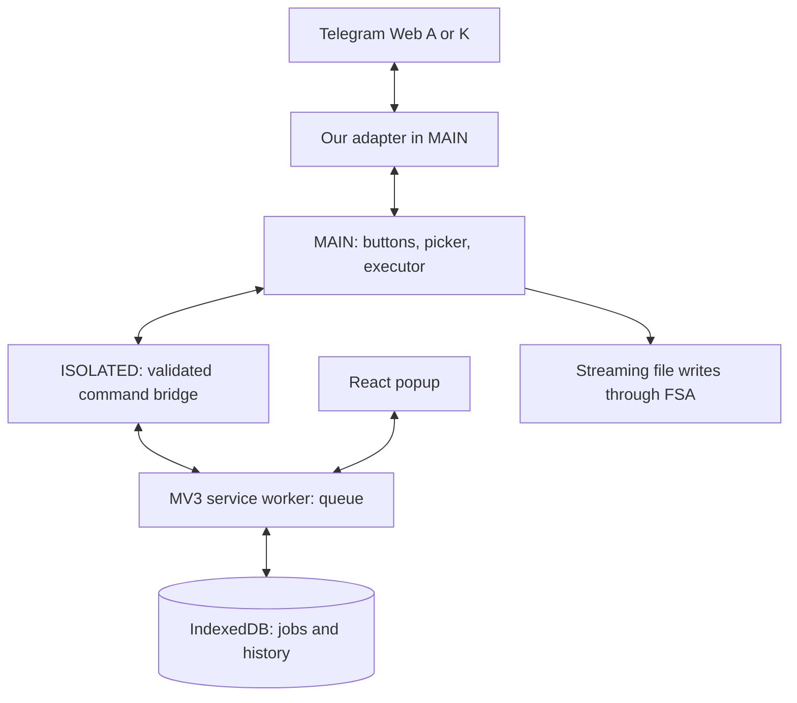

# Telegram All Downloader — Product and Implementation Plan

Date: October 9, 2026. Working title: **Telegram All Downloader**.

This is a historical product plan written before implementation. Its requirements and backlog are retained; the decisions made during development are recorded below. The new Telegram All Downloader has been implemented. Current live test results and limitations are tracked separately in [docs/compatibility.md](docs/compatibility.md); installation is covered in [README.md](README.md).

### Implementation Status and Decisions

- October 11 update, preview 0.2.0: at the owner's explicit request, selection of up to 200 discovered attachments, visible album items, filters, a single folder, filename templates/collision handling, and a separate manager with bulk cancellation and retry were added. This is part of T08; deduplication of completed downloads remains in the backlog. The new features are ready for the owner's manual acceptance testing; previous gaps in the live test matrix have not been declared closed.
- Web A/K adapters, a sequential streaming executor, a shared IndexedDB queue, coordinator recovery, buttons beside attachments, a popup, RU/EN, and themes have been created. Automated unit/integration/E2E tests use our own fixtures; on their own, they do not prove full compatibility with production Telegram.
- The WXT + TypeScript + React stack and Manifest V3 are in place. **npm** was selected for dependencies, with `package-lock.json` and `npm ci`, and Node.js 22 from `.nvmrc`.
- Saving uses **File System Access in Telegram's MAIN context**. Metadata preparation is limited to three concurrent operations. The picker opens synchronously on the user's click; the writer opens when the queued transfer starts. Closing the Telegram tab interrupts the dependent download; retrying requires selecting a save destination again.
- Bytes and the file handle remain in the source tab. Documents are read in chunks of up to 512 KiB; the executor's technical limit is 4 GiB. A separate 32 MiB limit applies to Web A photos returned in full by the client. These limits are not the results of live measurements with large files.
- Actual permissions: **`storage`** and narrow host access to `https://web.telegram.org/*`. `downloads`, `scripting`, `offscreen`, cookies, and debugger are not requested. Static content scripts run on `/a/` and `/k/`.
- Source code is at [alex100cent/telegram-all-downloader](https://github.com/alex100cent/telegram-all-downloader), under the [MIT](LICENSE) license. Third-party runtime code is listed in [THIRD_PARTY_NOTICES.md](THIRD_PARTY_NOTICES.md) and included in the ZIP. The donation button is hidden until a real URL is configured.
- M1–M3 are implemented in code. Full M0/M4 acceptance depends on the live test matrix, rather than the presence of code or passing fixtures. Yandex Browser is not installed in the development environment; the user will test it independently. Remaining acceptance work is described in [docs/manual-testing.md](docs/manual-testing.md).

Architectural details of the current path: [docs/architecture/transport.md](docs/architecture/transport.md), [Web A](docs/architecture/web-a.md), [Web K](docs/architecture/web-k.md). The sections on other saving paths below preserve the history of the options considered and do not imply that they are available in the MVP.

## 1. MVP: First, Reliably Download One Attachment

**Target MVP outcome:** the user opens Telegram Web, clicks a button next to a specific attachment, and receives that exact file in full, at the available original quality, with the correct filename. This works in public chats and private chats accessible to the user, including those with saving restricted, on tested versions of Web A and Web K.

### Scope Agreed with the User

- One file per action. Bulk selection, whole albums, and history exports come after the MVP.
- All message attachment types: photos, videos, music and podcasts, voice messages, round video messages, GIFs/animations, arbitrary documents, and stickers.
- Telegram Web `/a/` and `/k/` are both required.
- Chrome and Yandex Browser on **macOS**. Windows is the next phase; Linux, Firefox, Safari, and mobile browsers are outside initial support.
- A free, open-source extension with voluntary donations. No subscription, download quotas, or separate extension account.
- Stories and avatars come after the MVP.
- The popup opened from the extension icon contains downloads and a compact "Buy the developer a coffee" block.

### Original Order of Work Within the MVP

| Step | Work                                                                                                    | Result / condition for proceeding                                                                   |
| ---- | ------------------------------------------------------------------------------------------------------- | --------------------------------------------------------------------------------------------------- |
| M0   | Verify retrieval of specific media and writing it to disk in the four browser × Web client combinations | A table of proven capabilities; a small prototype of our own; a transport decision for each adapter |
| M1   | Create the project, models, message protocol, storage, and test data                                    | The extension installs in both browsers; modules do not depend on incidental DOM details            |
| M2   | Implement an end-to-end audio flow, then the other types                                                | Click → exact attachment → complete file → confirmed result; identical A/K semantics                |
| M3   | Add buttons, a minimal queue, a popup, and error handling                                               | Repeated clicks do not create duplicates; closing the popup does not interrupt work                 |
| M4   | Test the matrix and prepare an installation ZIP and instructions                                        | The MVP can be installed and used on macOS; limitations are explicitly documented                   |

**M0 is a mandatory phase, not an additional research project.** The main risks are accessing Telegram data and saving large files. The original sequence called for testing these parts before the interface, starting with music/podcasts. Implementation and tests using our own fixtures are already complete; live acceptance testing remains a separate mandatory phase.

If M0 does not find a reliable path for a required type in one client, this blocks the corresponding MVP matrix cell. Do not claim support for "all media," substitute a preview for the file, or silently drop the requirement. Record the result, propose a concrete alternative, and discuss the scope change with the owner.

### What the Minimal Interface Includes

- A download button beside the attachment; for photos/videos, also in the open viewer. One operation per attachment, including an individual album item.
- Name, type, and size, if known; a clear status on the button and in the popup.
- A sequential queue of files the user clicked individually. One active file by default; this is not bulk history collection.
- Cancellation, retry of a failed download, and prevention of duplicate starts for the same job.
- Local history that survives closing the popup and restarting the background process.
- Navigation to the source message when the adapter can reconstruct the link; showing the file in its folder for saving methods that support it.
- Light/dark themes, Russian and English interfaces, and keyboard controls.
- Brief instructions, an issue-reporting link, and optional donations.

### MVP Completion Criteria

1. Every row in the attachment matrix in section 3 passes in Chrome A, Chrome K, Yandex A, and Yandex K on macOS. Browser versions and the test date are recorded.
2. With our own test data, the selected document is saved: the expected bytes/hash match, not just the name and duration. For photos transformed by Telegram, the reference is the file available in Telegram.
3. Unplayed, unwatched, and partially played files download in full; a preview is not presented as the original.
4. A normal public channel, a normal private channel, and a private channel with saving restricted are tested. The privacy flag and the saving restriction are separate conditions.
5. There is no unsolicited audio playback, switching away from the user's current track, or change to the playback position.
6. A 1 GiB file completes through the streaming path without being buffered in full. The entire path is measured: retrieval within Telegram, transport, and writing; streaming a gigabyte Blob that has already been accumulated does not count as a solution. Before release, also test a file of around 2 GiB; around 4 GiB if such a file is accessible to the test account. Publish the limit actually tested, rather than a promise of "any size."
7. Going offline, cancellation, dismissing the file picker, write errors, expired sources, and closing the Telegram tab produce the correct state. An incomplete file is not marked as ready.
8. Stopping the extension service worker neither loses history nor starts a second copy of an already running download.
9. Third-party code/icons/demos from `Telegram-Downloader` do not enter the build; licenses are specified for our source code and included dependencies.

## 2. Product: Where to Be Better

The main usability benchmark is **[Private video downloader — Telegram Private Video Downloader](https://chromewebstore.google.com/detail/private-video-downloader/gdfhmpjihkjpkcgfoclondnjlignnaap)**, with the website [tgvideodownload.com](https://tgvideodownload.com/). The user previously purchased its subscription for a large number of downloads. Its usability is a confirmed benchmark from the user; we have not examined this extension's technical implementation.

Our main differences:

1. **Reliable matching to the message.** Especially for audio: the selected podcast is not replaced by a neighboring prefetched track.
2. **One clear process for every attachment.** Voice messages, round video messages, and documents are not treated as secondary variations of video.
3. **Accurate download status.** "Done" means a saved file, and an error includes an available action to resolve it.
4. **Open source and operation through the current tab.** No media transfer through our server and no new Telegram login.
5. **Convenient handling of many files after the MVP.** Selection, a queue, filters, tidy names, and duplicate exclusion.
6. **Updatable A/K adapters.** A failure affecting one type or client is isolated and diagnosable.

### What "Any Media Content" Means

For this product, it means all listed file types available to the current user in a supported Telegram Web client. The extension also works in channels the user has already joined. Gaining access to an unavailable channel, unpaid content, or a deleted file is not a product feature. Secret chats, calls, live streams, and one-time attachments unavailable to the web client are outside the promise.

Saving in a chat with `noforwards` is a separate mandatory test, not a consequence of channel privacy. Telegram describes this flag as restricting saving and forwarding; our path must be confirmed to work in a test channel. [Telegram: content protection](https://core.telegram.org/api/content-protection).

"Original quality" means the best complete file available in Telegram, without additional recompression by the extension. For an image sent as a photo, this is not necessarily the original before Telegram processing. Conversion is a separate future feature.

## 3. Feature and Format Matrix

### MVP Attachments

| Type                        | What we save                                                          | Required scenario                                                                  |
| --------------------------- | --------------------------------------------------------------------- | ---------------------------------------------------------------------------------- |
| Photo                       | The available full-size variant in its actual format                  | A photo from the feed, viewer, or individual album item; not a thumbnail           |
| Regular video               | The complete available original file with its audio track, if present | Not yet played; partially played; long video                                       |
| Music, podcasts, audiobooks | The original audio file: MP3/M4A/OGG/FLAC or another actual format    | Prefetch of a neighboring track, identical names, active player                    |
| Voice message               | The actual container/codec, usually OGG/Opus                          | No forced playback and no false `.mp3` extension                                   |
| Round video message         | The complete video file, usually MP4                                  | Audio and full duration; not a preview image                                       |
| GIF / animation             | The actual format, which may be MP4 in Telegram                       | Do not rename MP4 to `.gif`                                                        |
| Document / file             | The original bytes and a safely handled original filename             | PDF, ZIP, TXT, media sent as a document, unknown MIME, a file without an extension |
| Static sticker              | The original file, for example WebP                                   | Not a screenshot of the rendered sticker                                           |
| Animated / video sticker    | The original TGS/WebM or other provided format                        | Unplayed animation; the format is not replaced with GIF                            |

MIME and extension are determined from metadata and content. The examples in the table do not replace format detection. "Does not open in every system player" does not mean the filename extension should be changed or the file silently transcoded.

### After the MVP

| Priority | Feature                                                                | Purpose / boundary                                                                               |
| -------- | ---------------------------------------------------------------------- | ------------------------------------------------------------------------------------------------ |
| P1       | Select multiple messages; download an album                            | The next improvement to everyday UX; a file list before starting                                 |
| P1       | Download discovered attachments in the current chat with a type filter | Quickly collect podcasts/photos; explicitly show discovery coverage                              |
| P1       | Destination folder and filename templates                              | One folder selection per batch, ordered by date/message                                          |
| P1       | A full manager in a separate tab                                       | Filters, search, retrying failures, group cancellation, navigation to the source                 |
| P1       | Skip previously downloaded items                                       | Based on stable media identity; manual retry is always possible                                  |
| P1       | Windows: Chrome and Yandex                                             | Separate testing of filenames, dialogs, writing, and installation                                |
| P2       | Stories, avatars                                                       | New discovery surfaces on top of the shared downloader; only those accessible to the user        |
| P2       | Scan history for a date range                                          | Pagination or controlled scrolling; scan progress, stopping, recovery                            |
| P2       | ZIP and an export manifest file                                        | Compact transfer of a collection; streaming writes, reporting errors within the batch            |
| P2       | Parallel files and supported download resumption                       | After measurements and a verified saving mechanism; do not promise speed improvements in advance |
| P3       | Local conversion of voice → MP3, animations → GIF                      | Optional and separate from saving the original; assess WASM size and memory                      |
| P3       | Saved filter sets, keyboard shortcuts, accessible forum topics         | For regular use after the core process stabilizes                                                |

Do not include now: our own media server, separate MTProto authorization, an intermediary bot, an always-on background mirror of channels, AI processing, our own media player, a mandatory side panel, or a complex payment system.

## 4. UX: Main Flows

### Downloading One File

1. The user opens Telegram Web with an existing login session.
2. A button with the accessible label "Download file" appears beside a supported attachment. In compact blocks, it does not cover play, duration, or native actions.
3. Clicking captures the attachment's identity. "Preparing" or "Queued" appears immediately; clicking again shows the existing job.
4. The file is saved to Downloads through the browser if the verified backend permits it. If the streaming path with a file dialog is selected, the user chooses a file through an explicit action.
5. When the size is known, bytes and a percentage are shown; otherwise, an indeterminate indicator and the received byte count, if available. Preparation, transfer, and finalization are distinguished.
6. Once writing is confirmed, the status is "Downloaded." An error is retained in history and offers "Retry" or a specific action.

**For an album, the MVP downloads only the selected item.** Downloading the entire album will come in P1.

If the original can only be reliably retrieved from the viewer, the button may open the correct media while preserving its identity. This is an acceptable fallback, but not hidden audio playback. During M0, determine which types require this navigation.

### Popup

Top row: name, A/K connection status, settings. Then the active download and recent jobs: name, type, size/progress, cancel or retry. Below that: history and help. P1 adds "Open manager."

At the bottom is a compact card: "Enjoying the extension? Buy the developer a coffee." This is a normal external link, with no ad network, paid restrictions, or modal after every download. The destination is set in configuration; until a real link is provided, the action is hidden and no placeholder address is used.

Empty states: "Open Telegram Web," "Log in to Telegram," "No attachments found yet," "This Telegram version has not been recognized yet." The user sees the next step; technical details are available through diagnostics.

### Names and Folders

- Preserve the original filename by default if it is available and safe for the filesystem.
- If no name is available: `type_YYYY-MM-DD_messageId.ext`; add an index for multiple attachments.
- The current MVP uses a single-file File System Access picker. Automatic discovery of an unused filename is not promised: replacing an existing file requires confirmation in the system dialog. A folder selected in P1 will require our own safe unique suffix. If the Downloads API is added in the future, provide `conflictAction: uniquify`.
- Remove path separators, control characters, `..`, and dangerous/reserved names; limit length. Handle Unicode and names without extensions.
- In P1, add the template `Telegram/{chat}/{date}_{messageId}_{filename}` and a result preview. Including the chat name in the filename/folder is a setting, not mandatory disclosure of the source.
- The save destination in the MVP is selected through the system File System Access picker. The Downloads API was considered as a separate alternative and is not currently used.

### Completion, Closing, and Recovery

| Event                                | Expected behavior                                                                                                                            |
| ------------------------------------ | -------------------------------------------------------------------------------------------------------------------------------------------- |
| Popup closed                         | The download continues; reopening shows the current state                                                                                    |
| Extension worker suspended / stopped | State is read from storage and reconciled with the executor; no new duplicate is started                                                     |
| User switches chats                  | The selected job retains its original account/chat/media; if the source is lost, the user is prompted to restore it                          |
| Telegram account switched            | Source validation rejects the old job with `account_changed`; the user returns to the required account and retries                           |
| Telegram tab refreshed / closed      | The current FSA path is interrupted; after opening the source message, the user must select a destination again and retry                    |
| Browser restarted                    | History remains; unfinished work is reconciled with the live executor, and if it is lost, the user is offered a retry after opening Telegram |

Recovering the job list is not the same as resuming from the previous byte. In the MVP, a retry may start from scratch. Pausing an individual file and resuming are shown only when actually supported; stopping the queue from starting jobs is a separate action.

## 5. Stack and Project Structure

### Selected Foundation

| Area                | Decision                                              | Reason                                                                                         |
| ------------------- | ----------------------------------------------------- | ---------------------------------------------------------------------------------------------- |
| Extension           | Manifest V3, one Chromium build                       | Chrome and Yandex, without MV2 support                                                         |
| Build               | WXT + Vite                                            | Explicit entrypoints, convenient content script handling, a small integration layer of our own |
| Language            | TypeScript, strict                                    | Typed jobs, states, A/K contracts, and messages                                                |
| Popup               | React + plain CSS                                     | Components without a heavy design system; a separate manager remains in the backlog            |
| Buttons in Telegram | A minimal DOM layer, style isolation                  | Avoid mounting a React application on every message                                            |
| Message validation  | Zod runtime schemas                                   | Page data cannot be treated as trusted TypeScript objects                                      |
| Settings            | `chrome.storage.local`                                | Small settings, without syncing history through the browser account                            |
| Jobs / history      | IndexedDB through `idb`                               | Transactions, indexes, migrations; without storing all media in the database                   |
| Tests               | Vitest + Playwright + a manual matrix of real clients | Test data and lifecycle; DOM mocks do not prove Telegram integration                           |
| Tools               | npm, ESLint, Prettier, package-lock.json, CI          | Reproducible builds and low maintenance cost                                                   |

WXT was chosen as a convenient project foundation, not as a means of automatically downloading Telegram media. Plasmo is an acceptable alternative, but no advantages for our design justify a second stack. Both projects use MIT. Node is pinned in `.nvmrc`, allowed dependency ranges are in `package.json`, and exact versions are in `package-lock.json`. [WXT](https://wxt.dev/guide/essentials/content-scripts.html), [WXT license](https://github.com/wxt-dev/wxt/blob/main/LICENSE), [Plasmo](https://docs.plasmo.com/framework), [Plasmo license](https://github.com/PlasmoHQ/plasmo/blob/main/LICENSE).

Yandex supports Chrome/Opera extensions, but that does not guarantee compatibility with every API. A popup is required; `sidePanel` is not a necessary part of the architecture. The manifest specifies `minimum_chrome_version: 120`; versions actually tested are recorded separately in the compatibility table. This is the declared installation threshold, not proof of operation in every intermediate release. [Yandex: extensions](https://yandex.com/support/browser/en/personalization/extension).

### Separation of Responsibilities



Only control messages and metadata travel through extension messaging. The source, bytes, FileSystemFileHandle, and writer belong to the MAIN context of the source tab.

- **Web A / Web K adapter:** client detection, linking an element to a message/media, source resolution, and description of available capabilities. One client's markup is not used in the other.
- **Content script, ISOLATED:** a restricted bridge between MAIN and the extension, with schema, context, and routing validation.
- **MAIN controller:** our own buttons, DOM observation, metadata preparation, a picker on click, and management of live sources. Adapters use only the necessary access points in the current Telegram client.
- **Coordinator:** the queue, command acceptance, state persistence, linking jobs to tab/session, recovery through executor probes, and the badge.
- **Executor:** reads ranges and writes them sequentially to a file, reports progress and the result; depends on the source tab.
- **UI:** displays state and sends commands; the popup does not own the download.

The MAIN world shares the site's JavaScript environment. This does not automatically grant access to private module variables or Telegram Web Worker memory; the availability of each mechanism must be proven. [Chrome content scripts](https://developer.chrome.com/docs/extensions/develop/concepts/content-scripts).

### Implemented Structure

```text
entrypoints/
  background.ts
  telegram.content.ts
  telegram-main.content.ts
  popup/
src/
  domain/
  adapters/telegram-a/
  adapters/telegram-k/
  page/controller.ts
  downloads/stream.ts
  bridge/
  storage/
  ui/
  naming/
  i18n/
  config.ts
tests/
  e2e/
  *.test.ts
docs/
  architecture/
  compatibility.md
  manual-testing.md
public/
  icon/
  THIRD_PARTY_NOTICES.txt
```

Names and identifiers in code are in English. Project documentation and reports are in English; conversation with the owner is in Russian. The options/manager directories and other future surfaces are created when the corresponding backlog items are implemented.

## 6. Key Technical Decisions

### 6.1. Identity Before URL

The current model stores a stable description of the selected attachment:

- `accountId`, `peerId`, `messageId`, `mediaId`, optional `variant`;
- `client` — the A/K adapter;
- `tabId`, `sessionId` — the source tab and the job's document generation;
- `filename`, `mimeType`, optional `byteSize` and `sourceUrl`.

Store Telegram IDs as strings. `jobId` is a UUID; calculate the deduplication key separately. An identical name, duration, DOM node, or URL does not by itself prove identity.

Distinguish deduplication levels: the same attachment in a message versus the same document in another message. The MVP blocks duplicates of active jobs; in P1, the user can enable skipping previously downloaded documents.

The resolved URL and source access can expire. Do not store them as a permanent identity; before retrying, resolve them again for the same media and the same account. If there is no reliable link, return `ambiguous_media` instead of downloading "the latest audio.src."

### 6.2. Separate Adapter Contract

The implemented `MediaAdapter` contains `client`, `discover()`, and `dispose()`. A discovered `MediaCandidate` contains a key, a DOM anchor, and `resolve()`. The `ResolvedMedia` result provides `info`, `read(offset, length, signal)`, and optional `validate()` and `dispose()`. The shared executor does not depend on a specific client's DOM.

A more general `TransferPlan` with capability flags for multiple backends was initially considered. The MVP retains a single FSA path; pause/resume and other unsupported actions are absent from the UI.

Support for new DOM versions is localized in the adapter. If the structure does not match, disable the affected operation with an explanation; logic updates are delivered in a new extension build, without downloading executable code from a server.

### 6.3. How to Retrieve a File and Write It to Disk

The following options were considered in M0. The current implementation uses reading in Telegram's context with streaming writes through File System Access; the table preserves the history of alternatives:

| Candidate                                                                   | When to choose it                                                                          | What must be proven                                                                      |
| --------------------------------------------------------------------------- | ------------------------------------------------------------------------------------------ | ---------------------------------------------------------------------------------------- |
| Native download through a complete URL                                      | The resource is actually accessible to the browser's downloader                            | It is the complete file; authorization/context works; the exact `downloadId` is obtained |
| Calling the current Telegram Web client's existing downloader               | Specific media can be addressed without changing the player                                | Runtime accessibility; matching to the document; observable cancellation and completion  |
| Reading in Telegram's context → streaming writes through File System Access | A complete stream/ranges can be obtained and a file selected through an actual user action | Picker and write context; backpressure; errors/cancellation; operation in Yandex         |
| Blob as a fallback                                                          | Only a small file within a defined limit                                                   | Correct origin/lifetime, measured memory, observable save result                         |

Do not treat Web A/K HTTP routes as a stable public API. A similar URL in the source code or DOM does not prove that `chrome.downloads` will receive the same bytes: Telegram's own service worker may serve the download.

Platform constraints shaping the architecture:

- `chrome.downloads.download` accepts a URL, not a `ReadableStream`. When starting through this API, the `downloadId` association comes from the result; a delegated Telegram download needs separately proven correlation. Matching only by name and time is unacceptable. [Downloads API](https://developer.chrome.com/docs/extensions/reference/api/downloads).
- `blob:` is tied to an origin and partition; a video's `blob:` may be a MediaSource rather than a complete file. Such a URL cannot automatically be moved to the extension origin. [MDN: blob URLs](https://developer.mozilla.org/en-US/docs/Web/URI/Reference/Schemes/blob).
- File System Access requires a user action for the picker. Do not spend a long time resolving media, lose user activation, and only then open the dialog. Verify synchronous picker startup/an explicit "Save" action in the correct context. For a job that has waited in the queue, the original click no longer provides user activation: either the handle is obtained during the original action and held by the executor, or the job enters `waiting_destination` and asks the user to click "Save." Prefer opening the writer immediately before the transfer, without keeping unfinished writes open for the entire queue. The handle/writer do not belong to the popup and are not passed through JSON messaging; if the source context is lost, repeat selection when necessary. [File System Access](https://developer.chrome.com/docs/capabilities/web-apis/file-system-access).
- Runtime messaging in Chrome uses JSON. Do not transmit media as gigabytes of base64; the bridge carries commands and small metadata. A binary path or writing near the source must be verified separately. [Chrome messaging](https://developer.chrome.com/docs/extensions/develop/concepts/messaging).
- An offscreen document does not automatically gain access to Telegram data or the session. Add it only for a proven task with a correct `reason`, not as a universal background context for everything. [Offscreen API](https://developer.chrome.com/docs/extensions/reference/api/offscreen).

**MVP preference:** a verified native download with an observable result; if unavailable, streaming writes near the source. M0 ends with the selection of specific paths for A/K, rather than retaining four alternatives "for later."

If a Range downloader is needed: validate the response status, `Content-Range`, chunk boundaries/order, final size, and end of stream; correctly handle a server response of 200 instead of 206. Do not automatically treat a short response as the end of the file. Limit the buffer and number of requests, and wait for each write to finish. Determine chunk size and concurrency from source capabilities; do not copy a competitor's constants.

Verify SHA-256 against our own test files. In user downloads, check the available size and stream invariants; without a known reference hash, this is not cryptographic proof of identity.

When using Telegram's downloader, the expectation is to delegate file references and DC/CDN handling to it; M0 must confirm the behavior of the specific call point, request limits, and errors visible to the extension. This does not guarantee automatic recovery of every source. Do not add our own MTProto client or auth key reading as a hidden fallback. [Telegram files](https://core.telegram.org/api/files), [MTProto](https://core.telegram.org/mtproto).

### 6.4. Queue and State Persistence

Implemented job states: `queued → downloading → finalizing → completed`, plus `interrupted`, `failed`, and `cancelled`. Metadata preparation and file selection happen before enqueueing and do not occupy a network slot. Separate `resolving`/`waiting_source`/`waiting_destination` states and pause/resume were not introduced in the MVP. A retry creates a new attempt with a new ID; the previous result remains in history.

Storage contains: `id`, the deduplication key, `media`, `attempt`, `state`, `bytes`/`total`, timestamps, error code, `tabId`, and `sessionId`. File handles and bytes are not serialized. Transitions and periodic progress messages are persisted.

The coordinator must not rely on a global array. An MV3 worker can be stopped and its memory lost. On startup, it reconciles active records with the live executor in the source tab. It does not restart a job until reconciliation is complete. [MV3 service worker lifecycle](https://developer.chrome.com/docs/extensions/develop/concepts/service-workers/lifecycle).

A position in the shared queue is allocated by an IndexedDB transaction. The owner is identified by tab/session, and each attempt receives a separate ID. A missing response requires reconciliation with the live executor, not starting a second copy. The lease architecture from the original plan was not added separately. Cancel commands and repeated terminal events are idempotent.

The MVP has one active file globally. Retryable network errors allow no more than three attempts with increasing delays. Rate limits/FLOOD_WAIT are honored when available, without attempts to bypass them. `ambiguous_media`, lack of access, response format errors, and disk space errors are not resolved by endless retries.

The popup refreshes the list once per second while open; closing it does not stop the executor. `completed` is set only after a successful `writer.close()`. A write or finalization error is recorded as an error; "handed off to the browser" does not substitute for a successfully written file.

Cancellation aborts reading and the writer, and releases URLs/buffers. On a write error, the backend handles the temporary file/unfinished result. Do not delete a pre-existing user file. If the source cannot be stopped, do not show successful cancellation until stopping is confirmed.

### 6.5. DOM, Performance, Accounts

- Use a scoped MutationObserver for message containers and the viewer; process added/changed subtrees in batches.
- Do not repeatedly scan the entire `body` or run a frequent endless timer.
- Account for virtualization: a node may disappear or represent another message. Recheck identity on click, and pass the job its own description rather than a DOM reference.
- Do not add a second button on reinitialization. Remove observers, listeners, and old bindings when the client/page changes.
- Do not keep a React root on every message. Style isolation must not break Telegram's accessibility or clicks.
- Multiple tabs and accounts have separate source contexts but share a controlled queue. If accountScope cannot be established, bind the job to a specific tab session and do not transfer it automatically.

## 7. Access, Data, and License

### Minimal Permissions

Actual set: `storage`, host permission `https://web.telegram.org/*`, and static content scripts only for `/a/` and `/k/`. The selected FSA path does not require `downloads`. Do not request `<all_urls>`, cookies, debugger, browser history, or broad `file://` access. Access to a specific file/folder through a user-initiated File System Access picker is acceptable and differs from broad access to local files.

`scripting`, `offscreen`, and `alarms` are not currently requested. They may be added only with a separate justification for a new feature. Telegram domain aliases are supported only after separate implementation and testing.

### Trust Boundary

- The MAIN bridge and page data are treated as untrusted. Validate origin, source, tab/document, protocol version, requestId, schema, and allowed message sizes.
- Origin and a random nonce assist routing but do not protect against the page itself with the same origin. Decisions about privileged actions are made in the extension context, only for a known job.
- The page must not receive generic commands such as "download any URL," "open a path," or "delete a file." Validate source types, URL schemes, and association with the job; do not accept `javascript:` or arbitrary external addresses.
- Render names and labels as text, without `innerHTML` containing Telegram content. Code, fonts, and assets ship with the build; no remote code/eval. [Chrome Web Store MV3 requirements](https://developer.chrome.com/docs/webstore/program-policies/mv3-requirements).

### Local Data

Media travels from Telegram to the user's disk. There is no backend, cloud history, telemetry, or automatic diagnostic data submission.

The MVP stores settings and up to 500 completed records from the last 30 days. History can be cleared or disabled; changing numerical limits through the UI is not implemented. History may contain sensitive names/sources and is stored locally without a promise of encryption. Clearing history does not delete downloaded files. Unfinished jobs are not removed by automatic cleanup.

The MVP displays a clear error with a stable code and a link to the issue tracker. For a failed download, the popup previews diagnostics and copies them only on click: extension version and build, browser, A/K, type/MIME, rounded size, state, and error code, without auth keys, message text, private links, identifiers, or filenames. Nothing is sent automatically. Donation/issue tracker links open only on click.

### Our Own Implementation and License

New code is released under **MIT**; copyright is `2026 alex100cent and Telegram All Downloader contributors`. The full text is in [LICENSE](LICENSE), and third-party runtime code is listed in [THIRD_PARTY_NOTICES.md](THIRD_PARTY_NOTICES.md).

Telegram-Downloader was used as a product reference; its local copy is excluded from the repository and build. Do not copy JS/CSS, icons, GIFs, text, or implementation structure. The absence of an explicit license does not imply permission for arbitrary reuse of published code. [GitHub Choose a License: no license](https://choosealicense.com/no-permission/).

The source code of the official [Web A](https://github.com/Ajaxy/telegram-tt) and [Web K](https://github.com/morethanwords/tweb) clients can be used to study behavior; they are marked GPL v3. Do not automatically include their modules/bundles in the MIT project. Create our own adapters, record the sources used and versions tested. Do not call the source/report reading already performed formal clean-room development.

## 8. Tests That Prevent Previous Problems from Recurring

The preliminary local report on Telegram-Downloader described static analysis without live reproduction; this private working material is not published in the repository. It is a source of hypotheses and regression scenarios, not proof of the state of all current versions of the competitor. The current Telegram-Downloader README already claims audio support; the user's problem is its reliability, not simply a missing audio feature.

### Required Regression Set

| Group            | Scenarios                                                                                                          | Result to verify                                                                     |
| ---------------- | ------------------------------------------------------------------------------------------------------------------ | ------------------------------------------------------------------------------------ |
| Audio            | A podcast beside music; prefetch of the next track; an already cached track; identical names and durations         | The selected document's hash, no substitution or unexpected audio                    |
| Context          | Changing chat/account; two windows; identical message IDs for different peers; DOM recycling                       | Source and job are not mixed up                                                      |
| Quality          | A photo with multiple sizes; a video before viewing and after partial viewing                                      | The complete target variant, not a thumbnail or first chunk                          |
| Formats          | Voice, round video, MP4 animation, TGS/WebM sticker, unknown file                                                  | Original bytes, correct name/format                                                  |
| Lifecycle        | Close popup; stop worker; refresh/close Telegram; restart browser                                                  | History is retained, recovery is defined, no duplicates or false success             |
| Network and disk | Offline midway; broken Range; expired link; picker dismissal; insufficient space; cancellation during finalization | Bounded retries, correct error, closed resources                                     |
| Security         | HTML in a name; a long Unicode name; `../`; a forged bridge message                                                | No injection, folder traversal, or unrelated commands                                |
| Performance      | 100 MiB, 1 GiB, around 2 GiB; scrolling a long feed                                                                | Memory on the streaming path does not grow linearly with size; UI remains responsive |

### Test Levels

1. Unit: identity/dedupe, state transitions, retry, naming, Range validation, message schemas.
2. Integration: storage migrations, coordinator stop/recovery, stale events, cancellation and finalization, writer errors.
3. Playwright: MV3 installation in test Chromium, popup, synthetic Telegram DOM, our own test transfer sources. Do not treat this as testing production Telegram or Yandex.
4. Manual testing on macOS in real Chrome and Yandex × A/K, using our own test account/channels with synthetic files. Use the session available to the owner; do not place it in CI.

Reference files: short and long audio; two different audio files with the same name/duration; voice; round video; photo; video; animation; documents; three sticker varieties. Take reference hashes after Telegram processing if it changes the file. Do not upload personal conversations or private media to the repository/CI.

In `docs/compatibility.md`, record the date, OS, browser/extension version, A/K, known client build, type, size, backend, result, and conditions. Do not give a blanket green status based on one successfully downloaded video.

## 9. Phases After the MVP

### P1 — Convenient Collections and Bulk Actions

Sequence: select multiple files → album → type filter → destination folder → separate manager → Windows.

The user sees a preview of the list, a count, an available size estimate, and duplicate rules. "Download discovered" means exactly the attachments already discovered. Show unknown sizes separately; do not treat them as zero. Mixed outcomes are handled per file: one failure does not erase successful downloads.

Folder selection requires an actual user action; the backend checks access before the batch. The browser's "ask where to save each file" setting may affect the native path, so do not promise a single dialog without testing.

### P2 — History, Additional Surfaces, Archive

History scanning is a separate state machine with its own checkpoint, date range boundaries, number of messages examined, and reason for stopping. First verify reliable pagination in each client; an autoscroll fallback must be stoppable and explain that it controls the current tab.

Do not present items found in the DOM as "the entire channel." Completeness can only be claimed after reaching a confirmed history/date range boundary. On failure or an inaccessible segment, show a partial result. Scan and select first, then download; automatic mode is a separate setting.

Stories and avatars receive their own resolvers and tests while reusing identity, the queue, and the backend. ZIP requires streaming writes, large archive/ZIP64 support when needed, buffer limits, and a manifest listing successful/failed files. Do not assemble a gigabyte ZIP in memory.

### P3 — Additional Conveniences

Conversion and advanced resume are separate projects after basic downloading is reliable. Resume is possible only with stable source identity, validation of already written ranges, file permission, and backend support. If recovery is impossible, offer a complete retry rather than a corrupted splice.

## 10. Task Handoff to Claude Code

Each task ends with a verifiable result and a brief report: what was done, what was tested, and known limitations. Originally, P1+ depended on full MVP acceptance; on October 11, the owner separately requested batch downloading, a folder, and a manager before their own testing. Other dependencies remain. Confirm assumptions about internal APIs through experiments; do not present them as completed integrations.

The table preserves the original breakdown. T01–T05 code has already been created, and T07 artifacts are partly prepared; do not restart these phases. Open research and live acceptance scenarios for T00/T06 are defined by the compatibility document. Selection, a folder, and a manager are implemented in T08; deduplication of completed downloads and T09–T12 remain in the backlog.

| ID   | Depends on | Task                                                                                       | Completion criterion                                                                                     |
| ---- | ---------- | ------------------------------------------------------------------------------------------ | -------------------------------------------------------------------------------------------------------- |
| T00  | —          | Investigate A/K, identity, and the path to disk; test every required type and a large file | `docs/architecture/transport.md`: selected backend per client, evidence, limits, blockers; our own spike |
| T01  | T00        | Initialize WXT/TS/React, manifest, tooling, MIT/notice, CI                                 | Installation in Chrome/Yandex on macOS; build/typecheck/lint; only justified permissions                 |
| T02  | T01        | Models, schemas, storage, queue/reconciliation, fake backend                               | Worker stopping, duplicate commands, stale events, retry, and migration tested                           |
| T02b | T00, T02   | Shared FSA executor: writing, result observation, cancellation, picker lifecycle           | Actual bytes reach disk; memory, writer errors, and handle/source ownership tested                       |
| T03  | T02b       | Web A adapter and end-to-end downloading of every type                                     | Our own fixtures pass the full A matrix; stable audio identity                                           |
| T04  | T02b       | Web K adapter with the same contract                                                       | Our own fixtures pass the K matrix; no dependence on A selectors                                         |
| T05  | T02–T04    | Buttons, popup, states, history, naming, i18n, and donation configuration                  | The full MVP flow is available without DevTools, including errors and cancellation                       |
| T06  | T03–T05    | Live matrix, memory/large files, privacy, build ZIP, and installation                      | MVP criteria from section 1 met; results and limitations recorded                                        |
| T07  | T06        | Our own icons, GIFs/videos, README, release notes, and store materials                     | Demos show the actual build; links and promises match capabilities                                       |
| T08  | T06        | Selection/album, discovered-media filters, folder, manager, and dedupe                     | Batch preview, partial success, retrying failures; no hidden history scanning                            |
| T09  | T06        | Windows support                                                                            | The same matrix in Chrome/Yandex on Windows, safe names, and working dialogs                             |
| T10  | T08        | Investigate and implement history scanning                                                 | Date range, checkpoint, stopping, proven coverage, and accurate partial status                           |
| T11  | T06        | Stories and avatars                                                                        | A separate matrix for new A/K surfaces, saving the complete available file                               |
| T12  | T08/T10    | Streaming ZIP, manifest, optional resume/concurrency                                       | A large batch without linear memory growth; failures and recovery tested                                 |

T02b has one owner for the shared executor/writer. T03 and T04 can be delegated in parallel once it is ready and contracts are fixed; they do not create independent copies of the downloader and coordinate changes to shared types. T07 and T09 are also independent after a stable MVP. Do not develop multiple downloaders in parallel before T00 is resolved.

### Handoff of Remaining Work

> Read `README.md`, `PLAN.md`, `docs/architecture/transport.md`, `docs/compatibility.md`, and `docs/manual-testing.md`. The basic MVP is already implemented; first close the documented gaps in live acceptance testing and fix any regressions found. The user tests Yandex Browser independently. After MVP acceptance, proceed to T08–T12. Do not replace live testing with fixtures or declare unconfirmed scenarios supported. Write code and identifiers in English. Project documentation and reports are in English; conversation with the owner is in Russian.

## 11. Release, Onboarding, and Maintenance

- For the MVP: `npm run zip` builds the installation ZIP; CI checks the source code and saves the artifact. Repository: [alex100cent/telegram-all-downloader](https://github.com/alex100cent/telegram-all-downloader). The ZIP includes our extension and licensed runtime dependencies; local working materials and the competitor copy are excluded.
- For a public release: our own icons, README, LICENSE, THIRD_PARTY_NOTICES, privacy policy, a permission list with explanations, changelog, compatibility table, issue template, and release artifact. Submission to the store does not guarantee acceptance; installation from the release ZIP remains an independent option.
- Record our own short videos: installation; one photo/video; podcast and voice; cancel/retry; popup. After P1, add a collection/album. Use our own demo channel, without personal conversations.
- Keep compact GIFs and posters in the repository, with MP4/WebM in release assets if needed; add clear links in README and popup/help. Select a specific video host when preparing publication.
- Donations use one configurable URL, without payment SDKs in the extension. The user will provide the address before public release; a missing address does not block the downloader.
- Build from the lockfile in CI; the release ZIP contains only our extension. Record the artifact checksum and the corresponding source commit.
- When Telegram changes break functionality, fix the affected adapter, add an anonymized fixture and regression test, and release a new version. Do not promise perpetual compatibility with a constantly changing Web UI.

The name, copyright, and repository URL are already set. A real URL still needs to be provided to display the optional donation action. Store publication and demo materials are a separate phase after acceptance.

## 12. Competitor Comparison and Basis of the Plan

Information was checked against public pages on October 9, 2026. Competitor extensions were not installed during planning; the listed capabilities are their claims unless otherwise stated. Prices and ratings are not used to choose the architecture.

| Product                                                                                     | Claimed capabilities                                                                                                                                                      | Implication for our product                                                                                                                                                                                                                                                             |
| ------------------------------------------------------------------------------------------- | ------------------------------------------------------------------------------------------------------------------------------------------------------------------------- | --------------------------------------------------------------------------------------------------------------------------------------------------------------------------------------------------------------------------------------------------------------------------------------- |
| **Private video downloader — Telegram Private Video Downloader**, the user's main benchmark | A button beside media, photos/videos/GIFs/audio, large files; the website also lists voice, documents, and a batch queue. The store lists a free quota and a subscription | A benchmark for simple UX; ours has no quotas, an explicit type matrix, and precise identity. [Store](https://chromewebstore.google.com/detail/private-video-downloader/gdfhmpjihkjpkcgfoclondnjlignnaap), [website](https://tgvideodownload.com/)                                      |
| **SuperZombi Telegram-Downloader**                                                          | Photos, audio, video; different A/K integration methods, popup manager, donations                                                                                         | Retain the simple button; use the audio problem as a regression scenario and write a new implementation. [README](https://github.com/SuperZombi/Telegram-Downloader)                                                                                                                    |
| **Telegram Download Assistant**                                                             | A/K, individual and group downloads, resource counter, media for a month                                                                                                  | Adopt discovery/selection and filters in P1, and state coverage. [Store](https://chromewebstore.google.com/detail/telegram-video-downloader/fpapnfccelgjjlebjpcoleffhmgjendl)                                                                                                           |
| **TG Content Downloader**                                                                   | Media, voice, documents, Stories, a queue, names, and progress; the website states that downloading depends on the Telegram tab                                           | Explain the lifecycle explicitly. Website and store information about quotas/A–K differs; do not treat it as verified compatibility. [Website](https://tgdownloader.com/), [store](https://chromewebstore.google.com/detail/tg-content-downloader-tel/kijmncepdjeabghcjppndcgbogkfhbje) |
| **TGDownloader**                                                                            | Multiple selection, ZIP, audio/voice/documents; paid advanced features                                                                                                    | Collections and ZIP are useful after the MVP but require proper handling of large data volumes. [Website](https://tgvideodownloader.online/)                                                                                                                                            |

The main paid benchmark already claims broad media support, so a promise of "we support audio" is insufficient. The difference must be proven through reliability, no quotas, and the quality of the everyday workflow.

The original plan is based on the owner's requirements and answers, private working notes, and the public product pages above. Private notes and the local competitor copy are not included in the repository. [PR #6](https://github.com/SuperZombi/Telegram-Downloader/pull/6) was provided by the owner; its current status has not been independently confirmed and does not affect implementation of the new extension.
