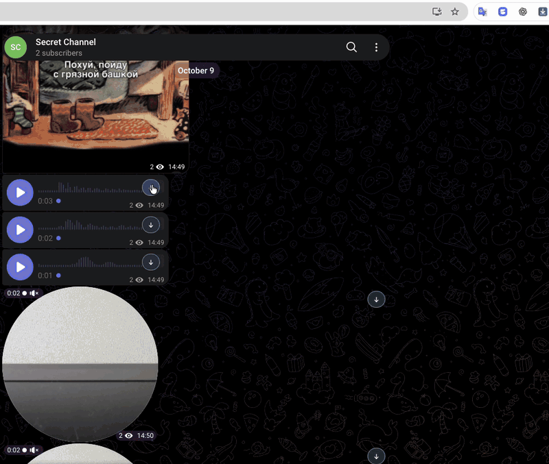

# Telegram All Downloader

**100% free and open source.** Save media from **Telegram Web A and K** in a few clicks, including private and protected channels you can access.

No subscriptions, paywalls or analytics. Files download through your existing Telegram session directly to your device. Your media and download history are never sent to the developer.

**[Install from the Chrome Web Store](https://chromewebstore.google.com/detail/telegram-all-downloader/lpaojniichemaogjmkfinkpflcppfhec)**



## Features

- Photos, videos, audio, voice messages, video messages, animations, documents and stickers.
- Download buttons next to attachments.
- Select up to **200 discovered attachments** and save them to one folder.
- Download manager with progress, search, filters, cancel and retry.
- File naming templates and options to keep both, skip or overwrite duplicates.
- English and Russian; light and dark themes.

## Installation

Install from the **[Chrome Web Store](https://chromewebstore.google.com/detail/telegram-all-downloader/lpaojniichemaogjmkfinkpflcppfhec)**, then open [Telegram Web A](https://web.telegram.org/a/) or [Web K](https://web.telegram.org/k/). Reload any already-open Telegram tabs.

<details>
<summary>Build from source</summary>

Clone or download this repository. With **Node.js 22.18+** installed, run in the project folder:

```sh
npm ci
npm run build
```

1. Open `chrome://extensions` in Chrome.
2. Enable **Developer mode** and click **Load unpacked**.
3. Select the project's `.output/chrome-mv3` folder.
4. Open [Telegram Web A](https://web.telegram.org/a/) or [Web K](https://web.telegram.org/k/). Reload any already-open Telegram tabs.

</details>

## Usage

Click **↓** next to an attachment to save it. For a batch, open the extension, click **Choose files in Telegram**, select attachments, then **Choose folder and download**. Open **Download manager** to track your downloads.

Keep the Telegram tab open while downloading. Batches include discovered attachments, not the entire chat history. Files keep Telegram's format; animations may save as MP4.

**0.2.1 preview · Tested in Chrome on macOS.** See [compatibility and known limits](docs/compatibility.md) for format coverage and other browsers.

[Changelog](CHANGELOG.md) · [Roadmap](PLAN.md) · [Privacy](PRIVACY.md) · [Report an issue](https://github.com/alex100cent/telegram-all-downloader/issues) · [MIT License](LICENSE)

## Support the project

If this extension saves you time, [☕ buy the developer a coffee](https://app.lava.top/294798508). Donations are optional — every feature stays free.

You can turn off coffee reminders in **Settings**, where you can also switch the interface from English to Russian.
